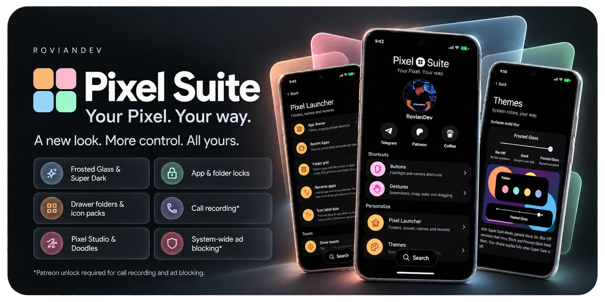

# Pixel Suite 3.0.0

Your Pixel. Your way.

Made by **RovianDev**. An open-source LSPosed module for Pixel phones: launcher customization and icon packs, navigation buttons, app and folder locks, gestures, screenshot tools, share menu tools, call recording, ad blocking and more. Every feature has its own switch.

**Open Pixel Suite from your home screen:** touch and hold an empty area, then choose **Pixel Suite settings**.

[📥 GitHub download](https://github.com/RovianDev/PixelSuite/releases) · [📥 Xposed download](https://github.com/Xposed-Modules-Repo/io.github.roviandev.pixelsuite/releases) · [Full 3.0.0 release notes](RELEASE-NOTES-v3.0.0.md) · [Changelog](CHANGELOG.md)

## What's new in 3.0.0

The biggest Pixel Suite release yet:

- 📤 **Share menu tools:** reorder pinned apps and contacts, hide apps and contacts into folders.
- 🖼️ **Pixel Studio, reimagined:** pinch to zoom, an all-new text tool on the picture, the whole picture kept after a crop, a floating colour menu.
- 🎨 **Icon packs** for Pixel Launcher, cut into your icon shape.
- 📞 **Call recording** in the Google Phone app, in any country, without the announcement.
- 🚫 **Ad blocking** system-wide, in Chrome and Google News, plus an ad-free Google feed.
- 🔕 **Do Not Annoy:** silence incoming calls while staying connected.
- 🛡️ **OTA & Store blocker:** keep your system and chosen apps on their current versions.
- ⌚ **Pixel Watch eSIM** setup with a QR code, in any country.
- 🧭 **Navigation buttons** beside the gesture bar, with Circle to Search or Gemini on a long press of Home.
- 🍞 **Toasts:** show every toast at the top, in the middle or at the bottom.
- 💠 **A fresh look:** a redesigned app with search across every setting, and glass rims on Frosted Glass panels.
- 📱 **More Pixel Launchers supported**, and fixes for bugs in Google's own apps.

See the [full release notes](RELEASE-NOTES-v3.0.0.md) for every change.

## 📤 Share menu (Share menu > Share sheet tools)

- **Reorder pinned apps** by dragging; extra pinned rows when one is full. Pinned apps aren't listed twice.
- **Hide apps** into a **Hidden apps** folder, one by one or several at once with **Edit**. Tap a hidden app to share to it; long-press to unhide.
- **Contacts:** reorder pinned contacts, hide contacts into a **Hidden contacts** folder, or fold the whole contacts row away.
- Long app names stay on one line. Folders and panels follow your surface style and theme.
- Google Photos' share page now uses the share sheet's own colours instead of plain white.

---

## 🖼️ Pixel Studio, reimagined

- **Zoom:** pinch to zoom up to 5x and pan, anywhere in the editor. While zoomed, the pen, highlighter and eraser draw right under your finger, and crop corners stay under it. Save and Share are unaffected.
- **All-new text tool:** type right on the picture, live, in your chosen font and colour.
  - Only ✓ saves, in the top bar or on the text's frame; ✕ deletes.
  - A saved text keeps a frame: drag to move it, side handles re-wrap the words, corner handles resize it. Two fingers on a text zoom the picture, like anywhere else.
  - A floating fonts and colours menu above the tool bar or keyboard, compact or full width, that you can drag or flick.
  - Typing on a cropped picture shows the cropped part right above the keyboard.
- **The whole picture after a crop:** other tools keep the picture in place, the cropped part where the box was and the rest softly blurred around it.
- **Crop from any tool:** grab a crop corner from any page and keep dragging.
- **Pen stays inside the crop:** after a crop, strokes stay within the cropped area.
- **Floating colour menu** for the pen and highlighter, in the style of the Doodles menu.
- **The tool bar is always there**, also while a text or sticker is selected.
- **Pen strokes on top** of texts, stickers and Doodles' shapes, on screen and when saved.
- **Sticker grabbers:** resize stickers from their corners, with undo.
- One menu at a time: the pen, colour, text and Doodles menus close each other.
- Doodles: two fingers now zoom and pan the picture; small shapes move without growing. After a crop, new shapes are drawn only inside the cropped part (existing ones can still be moved anywhere).
- Crop only from the four corners, so swiping in from an edge no longer crops by accident.

The new text tool needs Pixel Studio 2.3.001; on other versions, Pixel Studio's own text tool is used.

---

## 🎨 Icons

**Icon packs** (Themes > Choose Icon pack)
- Use any standard icon pack from the Play Store or sideloaded (ADW / Nova / Lawnchair format).
- Covers the home screen, folders, the dock, the app drawer and drawer search.
- Every pack icon is trimmed and cut into the icon shape you chose in Wallpaper & style, with clean, smooth edges in every shape.
- Apps the pack doesn't include keep their own icons, including themed icons. Packs that use Material You colours follow your phone's colours.
- Changes apply live with a smooth crossfade, no launcher restart. Icons are prepared in advance, so scrolling stays smooth.
- Pick one app's icon from any pack: long-press the app > **Change icon** > **Icon pack**, with search and the app's matching icons first. **Reset icon** goes back.

**Colorful icons in the app drawer (Stock)** (Themes > Change icons)
- An option for a stock-looking drawer: with themed icons on, the app drawer, its suggestions, drawer search and drawer folders keep each app's own colours. The home screen stays themed.

---

## 💎 Google apps (Patreon)

Support Pixel Suite on Patreon and sign in inside the app to unlock these. Locked features are clearly marked and stay off until unlocked.

- **📞 Call recording** in the Google Phone app: works in any country, automatic or manual, and without the "This call is now being recorded" announcement. A copy of each recording is saved as M4A, named after the contact and time, in Recordings/Calls or a folder you choose.
- **🚫 Ad blocker:** blocks ad and tracker domains for every app and browser, even with Private DNS on, using the HaGeZi Multi LIGHT, AdAway and EasyList lists, updated daily.
  - **Chrome:** ads on web pages are hidden with EasyList's element rules, so no empty boxes or gaps are left. "Allow ads" and "turn off your ad blocker" pop-ups, sticky ad bars and floating video ads are removed too, and the page scrolls normally again.
  - **Chrome's new-tab feed:** sponsored stories disappear completely as you scroll, and so do the "Is this a good recommendation for you?" prompts.
  - **Google News:** cleaner articles, without ads.
- **📰 Hide ads in Google feed:** sponsored cards in Discover (and the launcher's left page) disappear completely, frame and gap included.

The pass is checked on your phone and works within seconds, no restart.

---

## 🔕 Do Not Annoy

Silence every incoming call while your phone stays connected. Data, Wi-Fi, outgoing calls and messages keep working.
- On Pixels with Pixel's calling stack (Pixel 10 and later), callers hear that your phone is switched off or unavailable. On other phones, calls are declined.
- Emergency calls always ring.
- Each silenced call shows a notification with a **Call back** button and a call log entry.
- Quick Settings tile included.
- **Pixel Watch with LTE:** also turns your watch's own mobile network off and back on, with the **Pixel Suite Watch** app (separate download).

---

## 🛡️ OTA & Store blocker

- **OTA blocker:** stops system update checks and downloads, and removes Software updates from Settings. **Lock factory reset** greys out Erase all data while it's on.
- **Play Store blocker:** chosen apps stay on their current version; the Play Store never updates them. Core Pixel apps are held back unless you choose **Unlock OEM apps**, and uninstalling or disabling them asks for your fingerprint or PIN.

---

## ⌚ Pixel Watch eSIM

**eSIM setup with a QR code** (Google apps > Pixel watch): the Pixel Watch app offers **Scan QR code** under Mobile network, even where Google says "No carrier supported". A one-time $10 purchase, yours to keep on your phone; Patreon is not required.

---

## 🧭 Navigation buttons (Gestures > Navigation buttons)

A hybrid navigation bar: the gesture pill stays, with a button on each side.
- Choose the left and right buttons: **Back**, **Home**, **Recent apps** or none.
- **Hold Home for:** Circle to Search, Gemini or nothing.
- Buttons follow the pill's light and dark colour and hide on the lock screen.
- With the keyboard open, the Back arrow turns down to close it.
- Swipes from the pill still go Home and to Recents. Taps are instant, with roomy touch areas.

---

## 🍞 Toasts (Pixel Launcher > Toasts)

Choose where every toast message appears: **Top** (as before), **Middle**, or **Bottom (Stock)**, where Android puts it. All toasts follow your choice, in your surface style and theme.

---

## ⚙️ Miscellaneous

- **Refresh rate slider:** a 60 / 120 Hz slider under Smooth display in Settings > Display & touch. The screen still drops to its lowest rate when nothing moves.
- **Show FPS:** a live frame counter at the top right for the app in front.
- **Backup & restore** (About and support): save your whole setup to one file (every setting, drawer folders and sorting, renamed apps, custom icons and share menu choices) and restore it anytime, even after clearing Pixel Launcher's storage or a factory reset. Patreon sign-in and the eSIM purchase aren't included; they stay tied to your account, and Patreon features only switch back on with an active Patreon pass.
- **Allow screenshots of secure screens** and **Hide accessibility from apps** are now built entirely on Pixel Suite's own code, with the same behaviour.

---

## 💠 A fresh look

- **Pixel Suite app redesign:** a new home header, colour-coded sections, **search across every setting**, panels that fit the screen, soft frosted scrolling edges, and an **LSPosed scope** guide on each feature page that lists exactly which apps to select.
- **Super Dark-Mode, deeper:** the app's sheets, dialogs, menus and fields share one pure-black palette, and pills and toasts are white on black.
- **Glass rims:** Frosted Glass panels, folders, menus, toasts and dialogs get a soft glass edge in light and dark theme, and Super Dark's soft rim in Super Dark-Mode, now also on Settings pop-ups. Blur Off keeps plain panels.
- **Soft frosted scrolling edges (Frosted Glass)** across the whole Settings app and the screens it opens (Google, Wallpaper & style, Permissions, Digital Wellbeing, Pixel Troubleshooting, Personal Safety), and in the app drawer, where apps fade softly under the search bar as you scroll.
- The app drawer always shows its **All apps** label under the suggestions.
- Open folders show their name in bold, on the left, and folders in the app drawer lift when you hold them, like apps.
- **Remove, Cancel and Uninstall** light up with an outline as an app reaches them, one at a time. Several selected apps fly into them together.

---

## 📱 More Pixel Launchers supported

Pixel Suite now works across more Pixel Launcher versions, including the newest builds with the redesigned app menu. Every feature is loaded on its own, so if a launcher version changes something one feature relies on, the others keep working.
- Pixel Suite's menu options (Create folder, Change icon, Rename, Lock) show on the new Pixel Launcher menu, and Hide app shortcuts works there too.
- Fixed a Pixel Launcher crash when opening an app's menu on newer launcher builds.
- Fixed dragging apps out of the app list, drawer folders and icon label sizing on newer launcher builds.
- Clear all, folder reordering, locked-app and folder protection, and the home screen's **Pixel Suite settings** row are adapted to the changes in newer launcher builds.

---

## 🐞 Bug fixes

- Pixel Studio: after typing a text and pressing ✓, opening Doodles or another tool could add a copy of the text.
- Double tap to sleep: right after a reboot, typing your PIN could turn the screen off.
- Custom and icon-pack icons: swiping an app away no longer briefly shows the stock icon flying back.
- Custom and icon-pack icons: a closed folder's small icons no longer snap to the themed icons at the end of the closing animation.
- Pixel Launcher: after moving several apps at once, Remove or Cancel could overlap Uninstall on the next drag.

---

## 🛠️ Google & Pixel bugs fixed

Bugs in Google's own apps that Pixel Suite now fixes:
- **Pixel Launcher:** themed icons had hard, stepped edges with a thin light rim in every icon shape. They're now drawn smooth, like normal icons.
- **Pixel Launcher:** closing a folder from its second (or later) page with a non-round icon shape (arch, cookie, clover…) blanked the page while the first page's icons trailed outside the folder. Folders now close cleanly from any page, in every shape.
- **Pixel Studio:** dragging a crop corner made a selected text jump around. It stays still now.
- **Pixel Studio:** tapping a text or sticker on the crop page threw away your crop. Your crop is kept.
- **Pixel Studio:** the tool bar disappeared while a text or sticker was selected. It stays.
- **Pixel Studio:** picking a pen could fold the tool bar down to that one pen. Fixed.
- **Pixel Studio:** selecting a text or sticker covered the pen strokes drawn before it. Strokes stay visible.

---

## Features

**Pixel Launcher**
- Drawer folders with their own grids and sorting, adaptive 3×3 / 4×4 / 5×5 home folder grids, and single-app folders.
- Rename apps and change icons (your own pictures or any icon pack); changes show everywhere, including Google search.
- Icon packs, colorful drawer icons, five icon label sizes and Hide app shortcuts.
- Drag to home screen, two-finger drag and moving several apps at once.
- Always-visible Clear all, locked cards in recents and a cleaner landscape recents.
- Navigation buttons beside the gesture bar, and a choice of where toasts appear.

**Privacy & Security**
- Lock apps and folders with your fingerprint or PIN, with blurred previews in recents and protection against uninstalling, disabling or removing them.

**Buttons and gestures**
- Power button flashlight, volume-down camera, three-finger screenshot, double tap to sleep, and tap or double tap to wake 📲.

**Screenshots and photos**
- Pixel Studio: free crop, Doodles (shapes and arrows), zoom, an on-picture text tool and more.
- Google Photos: editable Doodles, working completely offline.

**Themes**
- Super Dark-Mode (pure black), three surface styles (Blur Off, Stock, Frosted Glass) with glass rims, and soft frosted edges.

**Google apps** (Patreon)
- Call recording, system-wide ad blocking (also in Chrome and Google News) and an ad-free Google feed.
- Pixel Watch eSIM setup with a QR code (one-time purchase).

**More**
- Share menu tools, Do Not Annoy, OTA & Store blocker, newest-first file sorting, refresh rate slider, Show FPS, secure-screen screenshots, hiding accessibility or Developer options from apps, and a keyboard bar tweak.

## 🔒 Privacy

Pixel Suite has no ads, analytics or tracking, and the module itself never connects to the internet. The app goes online only to check for updates (you can turn this off), to download the Ad blocker's lists while it's on, and for Patreon sign-in or the eSIM purchase if you use them. Doodles, screenshots, photos and call recordings stay on your phone.

## 📥 Install and scope

**Root + LSPosed API 102 required.** Tested on Pixel 11 Pro with Android 17.

1. Install **PixelSuite-v3.0.0.apk** over your current version.
2. Enable Pixel Suite in LSPosed and grant its app root access.
3. Open Pixel Suite and turn on the features you want. Each feature page has an **LSPosed scope** section listing the apps to select for it.
4. Select those apps in LSPosed, then reboot.

Set up a phone screen lock before using Privacy & Security. Save editor work before changing an editor feature. Call recording may be restricted by your country's laws; obtain any required consent before recording.

## 💬 Community and support

[Telegram](https://t.me/RovianDev) · [Become a patron](https://www.patreon.com/c/RovianDev) · [Coffee](https://buymeacoffee.com/roviandev) · [Bug reports](https://github.com/RovianDev/PixelSuite/issues)

## Source and credits

GPL-3.0. Build instructions are in **BUILD.md**; artwork and list credits are in **THIRD-PARTY-NOTICES.md**. Release signing keys and private signing files are not distributed. Pixel Suite is an independent project and is not affiliated with Google.
