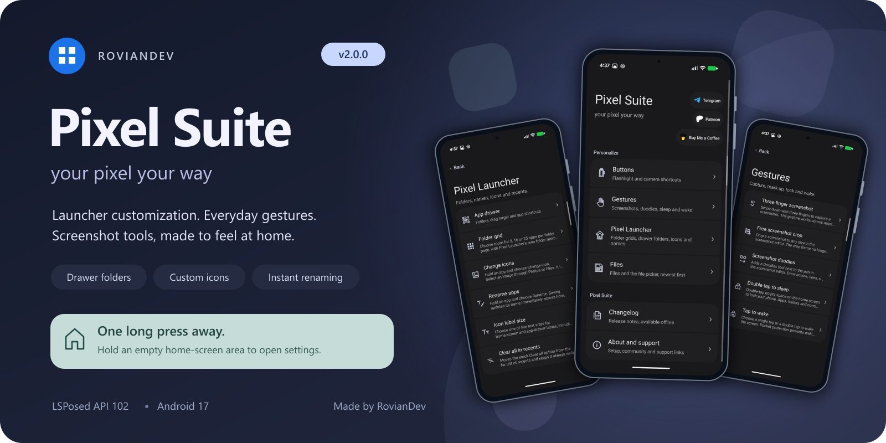
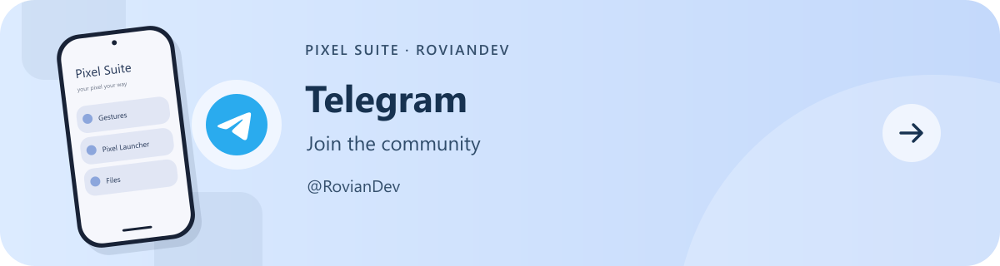
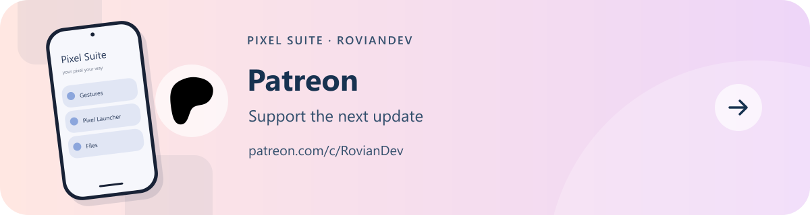
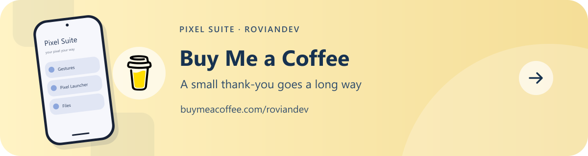

# Pixel Suite 2.0.7

Your Pixel. Your way.

Made by **RovianDev**. A free, open-source LSPosed module for Pixel customization, app and folder locks, gestures, screenshot tools and file sorting. Each feature has its own control.

**Open Pixel Suite from your home screen:** touch and hold an empty area, then choose **Pixel Suite settings**.

[📥 GitHub download](https://github.com/RovianDev/PixelSuite/releases/tag/v2.0.7) · [📥 Xposed download](https://github.com/Xposed-Modules-Repo/io.github.roviandev.pixelsuite/releases/tag/314-2.0.7) · [Full 2.0.7 release notes](RELEASE-NOTES-v2.0.7.md) · [Changelog](CHANGELOG.md)

## What's new in 2.0.7

🐛 **Fixes**

- Screenshot previews no longer go blank after the first screenshot with Reduce screenshot delay on.
- The first screenshot after a restart is instant again.
- Turning Reduce screenshot delay off no longer crashes the screenshot service.
- The status bar no longer flashes in recents when the phone is sideways with auto-rotate off.

## Features added in 2.0.6

## 🔒 **Privacy & Security**

- **Lock apps and folders** with your fingerprint or phone PIN. Open the app or folder’s long-press menu and choose **Lock**. Choose **Unlock** from the same menu to remove its lock.
- **Protect locked apps:** require authentication before uninstalling, disabling or pausing them, including uninstalling through the **Play Store**, or removing a locked folder. Cancel a folder’s removal, and it pops back into place.
- **Fingerprint prompt:** shows the locked app’s own icon and name, with a **Pin** button to switch to your PIN.
- **Private recents previews:** protected apps show a blurred preview and can’t be opened in split screen from recents.
- **Relock timing:** lock apps again as soon as you leave and folders when you close them, or enable **Keep unlocked for 1 minute**.
- **Animated padlocks** identify locked apps and folders on the home screen, in the drawer and in Google search. They animate when you lock or unlock.
- Deleting a locked folder or uninstalling a locked app removes its lock, so new folders and reinstalled apps start unlocked.
- A folder lock protects opening the folder. Its apps can still open from elsewhere unless you lock them individually.

**Setup:** select **System Framework, Pixel Launcher and System UI** in Pixel Suite’s LSPosed scope, then reboot. Your phone needs a screen lock configured.

## 🗂️ **Recent Apps**

- **Lock cards in recents:** choose **Lock** from a card’s menu to keep it when swiping or using **Clear all**. Tap its padlock badge to unlock it.
- **Separate split-screen locks:** lock either app independently. Clearing the pair removes unlocked apps while keeping locked ones.
- Recents locks survive a reboot. They protect the card from dismissal; Android can still close the app in the background.
- **Clear all:** locked cards fade back in, each removal gives a light tick, and the action row sits lower to make room for lock badges. Split pairs dim **Screenshot** and **Select** instead of hiding them.
- **Landscape view:** app names stay centered above their cards, and the status bar fades out. It returns when you rotate back or leave recents.
- **Always show Clear all** and **Lock apps in recents** now share the **Recent Apps** settings page.

## 🖐️ **Gestures**

- **Three-finger screenshot** responds faster and triggers more reliably.

## ⚙️ **Miscellaneous**

- **Reduce screenshot delay:** keeps the screenshot service ready so captures appear instantly, including the first screenshot after a restart. Uses a little extra memory while enabled.
- **Allow screenshots of secure screens:** take screenshots and recordings in apps that normally block them.
- **Hide accessibility from apps:** choose which apps cannot see your enabled accessibility services. The searchable picker includes user/system filters, and checked apps move to the top immediately.
- **Keyboard bar tweak:** hide the globe and move the dismiss arrow to the right in the bar beneath your keyboard (**Gboard and FUTO Keyboard**). Requires gesture navigation and restarts your keyboard when changed.
- **Hide Developer Options:** regular apps can’t tell Developer options, USB debugging or wireless debugging are on, so apps that refuse to open with them on work normally. Settings and debugging keep working as usual.
- **Developer options shortcut:** tap the animated gear to open Developer options. The gear works independently of the hiding switch; tapping the rest of the row toggles the option.

**Setup:** select **System Framework** for the screenshot, accessibility and Developer options controls. Select your keyboard for the keyboard bar tweak. Reopen apps that were already running after changing **Hide Developer Options**.

Remove **DisableFlagSecure** before enabling secure screenshots, and **DoNotTryAccessibility** before enabling accessibility hiding. Credits are shown under their respective options.

## 🎨 **Improvements**

- **Custom icon editor:** move and zoom your selected image before applying it, with **Reset** to restore its position and zoom.
- **Consistent icon shapes:** app icons and folder previews follow your chosen shape, including icons in Google search.
- **Themed icons:** now color every app in the drawer and the icons you drag together.
- **Adaptive folder grids:** folders resize to fit their contents. Grid choices appear from **3 apps**, with **4×4** available from **10 apps** and **5×5** from **17 apps**. Your larger grid choice returns as the folder fills.
- **Single-app folders:** folders can keep one app and still open and close normally.
- **Drag to home screen:** the pill lights up and gives a light vibration as soon as the icon touches it.
- **Split-screen previews:** improved how app previews fill their cards after leaving split screen.
- **Shortcut menus:** long-press menus stay beside the app instead of covering its icon.
- **Super Dark inside Pixel Suite:** the app now uses matching black backgrounds, cards, menus and dialogs when **Super Dark-Mode** and the phone’s dark theme are enabled.
- **Clearer settings:** revised descriptions, improved feature previews and updated setup notes.

## 🐛 **Fixes**

- Fixed apps disappearing after moving them between folders and the drawer.
- Fixed outdated folder previews and incorrect drag targets after moving apps.
- Fixed icon reset, thin edges around custom icons and inconsistent icon shapes.
- Fixed themed icons briefly flashing their original colors.
- Fixed app icons flickering in **Google search** while typing, and apps with the same name now show their own icons.
- Fixed the **Item removed / Undo** pill appearing in the wrong place, and it now follows **Super Dark**.
- Fixed a blue-grey flash when opening the **Google feed or Google app** with Super Dark on, and made **Settings search** fully black.
- Fixed missing **Super Dark** styling in uninstall dialogs.

## Frosted Glass Slider

Choose the look of supported folders, shortcut menus, toast messages, Google Photos menus and dialogs under **Themes**:

- **Blur Off:** solid surfaces, with window blur turned off. White in light mode, tinted black in dark mode.
- **Stock (Google’s own look):** Google’s surfaces, keeping your icon sizes and menu positions.
- **Frosted Glass (Modern):** blurred backgrounds with Pixel Suite’s tint. The default style.

**Super Dark-Mode** keeps surfaces black with blur off. When both Super Dark and the phone’s dark theme are active, turn off Super Dark before changing styles. Light mode remains unrestricted. The animated preview lets you see the styles without changing your settings.

## 📸 Doodles in Google Photos

**New scope:** select **Google Photos** in Pixel Suite’s LSPosed scope, restart Photos or reboot, then enable **Doodles → Google Photos**.

- New **Doodles** tab beside **Crop**, with shapes, arrows, colors, thickness, fill and delete controls.
- Save drawings and reopen the photo to move, resize, recolor or delete individual shapes. **Revert** removes saved Doodles.
- Shapes stay aligned while cropping, zooming and rotating. Crop from the photo edges with Doodles open.
- Supports **Ultra HDR** output and its gain map.

🔒 **Doodles works completely offline.** It runs inside Google Photos on your phone; all Doodles processing happens locally.

**Pixel Suite adds the Doodles tab and draws shapes over your photo while you edit. Photos’ own editor saves the result. Editable shapes remain in Photos’ private storage so you can adjust them later. Your account, subscription, device identity and backup settings stay as they are.**

## More Pixel Suite features

- **Drawer folders:** drag apps together, add apps and reorder folders. Choose **Auto (A–Z)** or **Custom** sorting from the three-dot menu.
- **Move several apps:** select a stack and move it into a folder or onto the home screen. Removing home shortcuts does not uninstall their apps.
- **Two-finger drag:** hold an app while another finger scrolls the drawer or changes home/folder pages.
- **Rename apps and change/reset icons:** changes appear instantly across the home screen, drawer, folders and Google search. Include **Google** in LSPosed for search customization. Private Space is excluded.
- **Icon label size:** five sizes without resizing icons, using your system font and Bold text setting.
- **Hide app shortcuts:** hide app-provided drawer actions while keeping launcher and Pixel Suite controls.
- **Buttons:** double-press **Power** for the flashlight or **Volume down** while the screen is off for the camera, with call/media safeguards.
- **Sleep and wake:** double-tap empty home-screen space to sleep; choose single/double-tap wake and Pixel Suite/Stock lock-screen behavior.
- **Pixel Studio:** free screenshot crop and Doodles with shapes, colors, snapping and Undo/Redo. Expand shapes/colors, collapse with the arrow, or drag/flick the toolbar vertically.
- **Newest first:** folders stay above files in Files by Google and Android's file picker.
- **Screen recording sheet:** puts **X** and **Start** below the options. Works with System UI in English.
- **In-app controls:** separate feature pages, light/dark themes, animated previews and an offline changelog. The restart shortcut reloads Pixel Launcher or Files after relevant changes.
- **Verified updates:** optional notifications for stable releases checked against both repositories. Download inside Pixel Suite with progress, verification and Android's installation prompt.

## 📥 Install and scope

**Root + LSPosed API 102 required.**

1. Install **PixelSuite-v2.0.7.apk** over the current official build.
2. Enable Pixel Suite in LSPosed and grant its app root access to save settings.
3. Select **System Framework, System UI and Pixel Launcher** for Privacy/Recents, and **System Framework** for the screenshot, accessibility and Developer options controls.
4. Select **Settings, Settings Intelligence, Google, Gboard and Package installer** alongside System UI/Pixel Launcher for Super Dark. Select **Google** for search customization.
5. Select **Pixel Studio** for screenshot editing, **Google Photos** for Photos Doodles, and **Files by Google** plus your **Files / DocumentsUI** picker for file sorting. Select **Gboard or FUTO Keyboard**, whichever you use, for the keyboard bar tweak.
6. Reboot, open Pixel Suite and choose your features.

Set up a phone screen lock before using Privacy & Security. Save editor work before changing its feature toggle. Reopen apps that were already running after changing Hide Developer Options.

## 💬 Community and support

[Telegram](https://t.me/RovianDev) · [Become a patron](https://www.patreon.com/c/RovianDev) · [Coffee](https://buymeacoffee.com/roviandev) · [Bug reports](https://github.com/RovianDev/PixelSuite/issues)

## Source and credits

GPL-3.0. Build instructions are in **BUILD.md**; artwork and module credits are in **THIRD-PARTY-NOTICES.md**. Release signing keys and private signing files are not distributed. Pixel Suite is an independent project and is not affiliated with Google.
